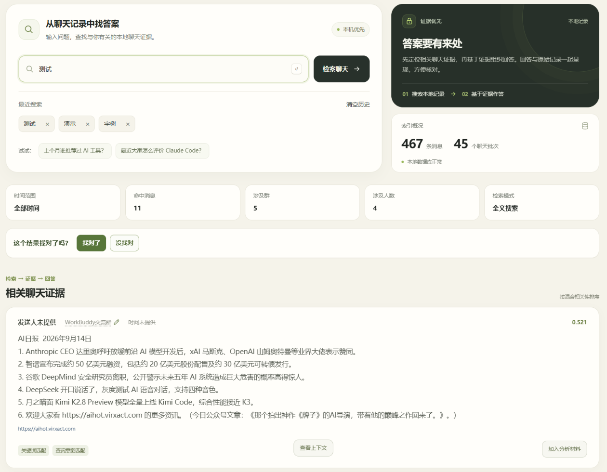
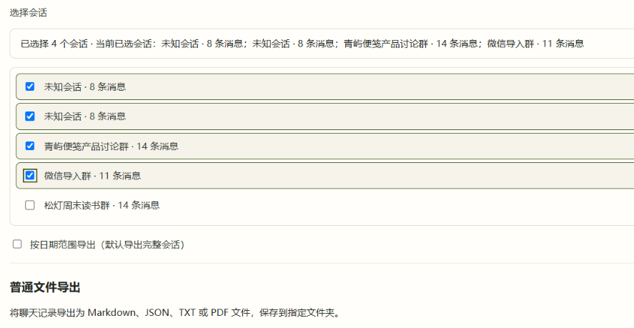
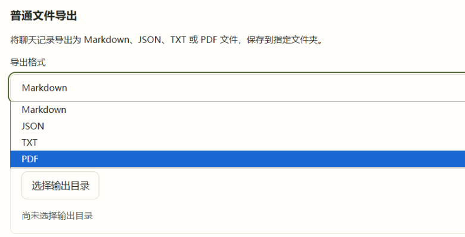
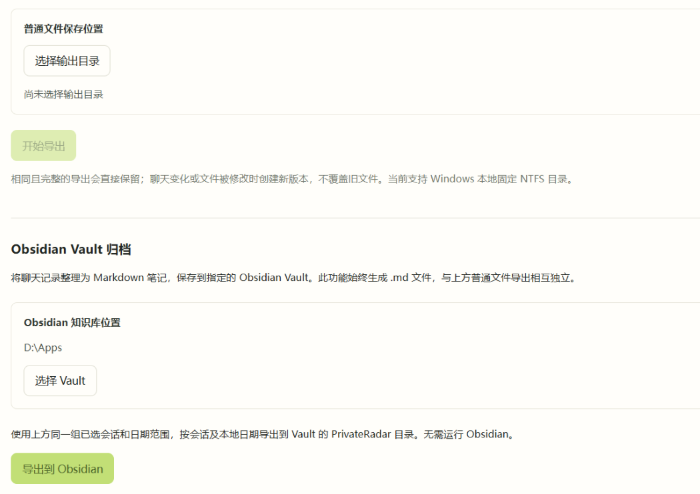
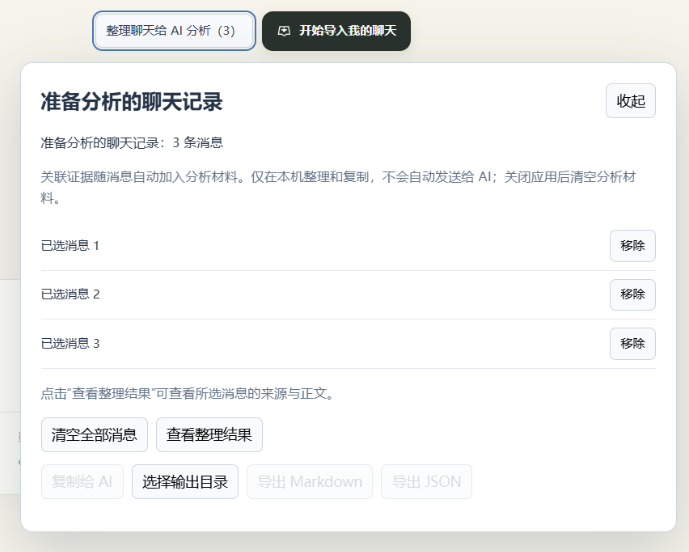

# PrivateRadar

把主动导入的聊天沉淀为可搜索、可追溯、可再次利用的本地聊天情报库。保留原文、来源与上下文，分析结果始终可以回到证据核对。

[](./LICENSE) 

**[下载 Windows v0.2.0-alpha.26（预发布）](https://github.com/moshangliu12-afk/PrivateRadar/releases/tag/v0.2.0-alpha.26)** · [本版发布说明](./docs/releases/v0.2.0-alpha.26.md) · [使用指南](./USER_GUIDE.md)

Windows 正式导入链：**微信 → WorkBuddy → PrivateRadar**；也支持 JSON / CSV / TXT 文件导入。PrivateRadar 不读取或破解微信数据库，不提取微信密钥。

alpha.26 已完成真实 Windows 桌面验收及 alpha.25 → alpha.26 正式覆盖升级验收，未检测到数据库分裂。macOS WorkBuddy 尚未支持；历史 macOS arm64 安装包及其验收边界单独保留，不能视为 alpha.26 Mac 发行。

## alpha.26 新能力

以下五张图片均为真实 alpha.26 Windows 界面，仅裁去无关区域，保留原始像素；点击图片可查看 PNG 原图。本机优先（Local First）、证据优先（Evidence First）：检索从本地聊天出发，结果可回到原文核对。

### 最近 6 条搜索与快捷重搜

- 只记录实际提交过的搜索词，本地最多保留最近 6 条；合理规范空白用于去重，重复搜索移到最前。
- 点击历史词直接重新搜索，支持单条删除、清空历史和重启后保留。
- 仅在原数据库的本地设置中保存搜索词，不保存搜索结果、聊天正文或 Evidence；搜索历史不上传外部服务，不新增外部网络请求。实际检索仍沿用原流程。

[](./docs/images/readme/alpha26-search-history.png)

### 会话复选框多选

- 每个会话旁有复选框，无需按 Ctrl 即可连续勾选或取消。
- 显示已选数量；点击外部或按 Escape 关闭，重开后保留选择，会话名称继续自动同步。
- 普通导出与 Obsidian 归档共用同一份选择和日期范围。
- 不设会话选择数量硬上限；超过 50 个仅提示可能耗时更长。导出逐会话执行，仍保留单会话及文件系统安全容量。

[](./docs/images/readme/alpha26-conversation-multiselect.png)

### 普通文件导出与 PDF

- Markdown / JSON / TXT / PDF 共用既有 Export Core、日期范围和安全写入机制。
- PDF 为正式 PDF 文件导出，沿用聊天来源信息和内容选择。
- “普通文件导出”与“Obsidian Vault 归档”分别显示，两个保存位置独立；Vault 始终生成 Markdown 笔记，不受普通导出格式影响。

[](./docs/images/readme/alpha26-pdf-export.png)

### 归档到 Obsidian 本地 Vault

- 在 Windows 选择本地 Vault，将聊天归档为 Markdown 笔记，包含 YAML Frontmatter 和日期组织。
- Manifest 记录导出状态；未变化内容重复导出不会生成重复文件，支持增量导出。
- 识别并保护用户手动修改过的笔记，避免静默覆盖。
- **PrivateRadar 仍为数据真源（Source of Truth）**；Vault 是导出副本，不从 Obsidian 反向同步到原库，也不自动复制附件。

[](./docs/images/readme/alpha26-obsidian-export.png)

### 整理聊天给 AI 分析

- 用户主动从聊天消息、Search 结果或 Evidence 选择需要的消息，在本地加入“准备分析的聊天记录”。
- 预览整理结果、调整所选材料，导出 Markdown / JSON，或“复制给 AI”。
- 此功能只准备本地材料，**不自动发送、不自动上传、不调用外部 AI API、不自动启动 Agent**。是否把材料交给其他服务，由用户决定；应用其他可选远程服务的边界见[隐私说明](./PRIVACY.md)。

[](./docs/images/readme/alpha26-ai-handoff.png)

## 持续保留的核心能力

| 能力 | 当前行为 |
|---|---|
| 今日情报 / 话题雷达 | 从已导入聊天中保守筛选值得关注的信息，保留原始依据与趋势来源 |
| Search / 问我的聊天 | 本地全文检索，支持关键词、日期、会话和人物条件，展开相关消息及上下文 |
| Evidence | 保留原始附件与来源出现位置，可回到对应来源核对；不补造未知信息 |
| Conversation Label | 自定义会话显示名称；清空后恢复来源名称，无来源名称时显示“未知会话”；重导入不覆盖用户名称 |
| Markdown / JSON / TXT Export | 按选择与日期范围导出聊天，保留已有安全写入与重复导出规则 |
| Historical Keyword Rescan | 手动“扫描历史聊天”，支持重复扫描去重和规则修改后重新扫描 |
| Keyword Rule Stats / Last Scan | 显示累计有效“命中”、最近发现、最近扫描时间和状态；不是只统计历史扫描 |
| 承诺候选 / 已确认表达 | 识别明确的第一人称行动表达，由用户查看依据、确认或忽略；确认不代表履行，也不自动生成任务 |
| WorkBuddy Connector | Windows 单卡与同次双卡正式来源链，保留独立 Evidence 及消息来源关系 |

私有聊天原文与索引默认保存在本机。来源事实、派生分析和用户确认分开保存：候选不是事实，分析判断不能替代原文。

## 仍有效的流程示例

本节保留图片均来自 alpha.22 的虚构演示数据，只说明仍有效的核心流程；不是 alpha.26 新界面截图。旧搜索入口已由上面的真实截图替换，旧关键词规则卡片不再展示，避免其过时的“不扫描历史”提示产生误导。五张新图的来源、裁剪与核对记录见[最终截图清单](./docs/releases/v0.2.0-alpha.26-screenshots.md)。

<details>
<summary>今日情报与原始依据（alpha.22 演示）</summary>


</details>

<details>
<summary>今日关注词与对应原始上下文</summary>


</details>

<details>
<summary>承诺候选的依据、确认与忽略</summary>


</details>

## 下载与升级

| 平台 | 本版安装包 | 范围 |
|---|---|
| Windows x64 | `PrivateRadar-Setup-0.2.0-alpha.26-x64.exe` | 未签名预发布版；正式覆盖升级已人工验收 |
| macOS | 本版不提供 macOS 安装包 | 历史 arm64 包见 [alpha.22 发行页](https://github.com/moshangliu12-afk/PrivateRadar/releases/tag/v0.2.0-alpha.22)，不支持 macOS WorkBuddy |

正式 Windows 安装包大小：**113,660,255 字节**；SHA256：

```text
3dc908232d105ab9899d17798896b8f47b91f7768c89deb157e7e8d0953b27f4
```

从 alpha.25 升级前，正常关闭 PrivateRadar、WorkBuddy 和连接器，完整备份并校验原数据目录（包括主库、存在的 WAL/SHM、Connector、Evidence、附件及其他数据），再使用正式安装器在原位置覆盖升级。不要先卸载或清理 AppData，不把备份作为运行数据库。升级后核对原有聊天、Evidence、会话名称、关键词数据及原库路径。

Windows 可能显示 SmartScreen / 未知发布者提示；核验来源和摘要后，仅按系统提供的单次选项继续，不关闭系统安全功能。详细步骤见[使用指南](./USER_GUIDE.md)。

## 数据安全与验收边界

- alpha.26 不新增数据库表或迁移，不新增依赖，不改变原有数据存储路径。
- 用户已确认 alpha.25 → alpha.26 正式 Windows 覆盖升级通过，未检测到数据库分裂，原有核心数据保留。
- 已验收安装包的构建源码固定为 `e6265cc192ee9d9bc1259e0d1e2447a4befffe05`。后续公开文档提交不改变该安装包身份，也不重新构建替换。
- 发布测试共 2,294 项：2,256 通过、36 项既有失败、2 项因缺少专用跨盘环境未执行。36 项包括此前已记录的 10 项，以及在已验收提交隔离复现的 26 项；本次新增回归为 0，alpha.26 专项 245/245 通过。不能将此记录表述为全套测试全绿。
- 类型检查、应用构建、MCP 构建和安装器静态核验通过；正式安装器内 106 个文件已逐项核验。真实人工验收与自动检查分别记录。

## 当前范围

尚未提供 macOS WorkBuddy、原生微信直接分享（Native WeChat Direct Share）、Semantic Search、Deep Link、Attachment Copy、Custom Local Data Location 或完整自主 Agent。

“整理聊天给 AI 分析”提供本地材料交接；PrivateRadar 不会据此自动分析、上传或执行任务。Windows 微信导入继续通过 WorkBuddy；macOS WorkBuddy 因缺少真实设备验证而暂停。不要将历史 Mac CI / DMG 检查或参考候选验收视为 alpha.26 Mac 实机验收。

## 源码开发与自检

开发环境要求 Node.js 24 或更高版本；使用现有锁文件安装依赖。普通 Windows 安装用户不需要 Node.js。

```powershell
npm ci
npm run dev
```

```powershell
npm test -- --maxWorkers=2 --testTimeout=30000
npm run typecheck
npm run build
```

应用构建包含 MCP 构建；Windows x64 安装器使用 `npm run dist:win`。当前锁文件使用 Electron 44.10.0。开发时的自检或重新构建不能替代已发布安装包的真实验收。

首次启动默认创建空数据库；可使用内置 Demo 体验，无需提交真实聊天。正式数据存储位置、开发目录覆盖及远程服务边界见[隐私说明](./PRIVACY.md)。

## 隐私与安全

- 不读取或破解微信数据库，不 Hook 微信，不提取密钥。
- 不向仓库或问题报告提交 API Key、Token、数据库或真实聊天导出。
- 本地搜索历史和材料交接功能不新增外部网络请求。
- 应用其他可选远程 AI / Embedding 服务由用户在本机独立配置；启用后，日报、刷新或搜索可能发送聊天证据，现有实现没有逐次确认门禁。该事实不因新增本地交接功能而改变，详见[隐私说明](./PRIVACY.md)。
- 数据库未实现加密，使用者应保护本机账号和备份。

## 文档与历史版本

当前使用：[使用指南](./USER_GUIDE.md)、[alpha.26 发布说明](./docs/releases/v0.2.0-alpha.26.md)、[文件导入格式](./IMPORT_FORMATS.md)、[隐私说明](./PRIVACY.md)、[安全报告](./SECURITY.md)、[贡献指南](./CONTRIBUTING.md)、[第三方许可清单](./THIRD_PARTY_NOTICES.md)、[WorkBuddy 技术契约](./src/main/integrations/workbuddy/README.md)。

历史版本：[alpha.25](https://github.com/moshangliu12-afk/PrivateRadar/releases/tag/v0.2.0-alpha.25)、[alpha.24](https://github.com/moshangliu12-afk/PrivateRadar/releases/tag/v0.2.0-alpha.24)、[alpha.23](https://github.com/moshangliu12-afk/PrivateRadar/releases/tag/v0.2.0-alpha.23)、[alpha.22](https://github.com/moshangliu12-afk/PrivateRadar/releases/tag/v0.2.0-alpha.22)。历史资产、标签及 FFmpeg 对应源码保留原发行身份，不以本轮文档重写。

[开发进度](./DEVELOPMENT_PROGRESS.md)、[已知问题](./KNOWN_ISSUES.md)、历史检查点及研究设计文档保留其各阶段结论；当前发行能力与验收范围以本页及 alpha.26 发布说明为准。

## 联系与许可

Bug、功能建议和公开讨论可使用 GitHub Issues；其他联系：[alenshao1@proton.me](mailto:alenshao1@proton.me)。安全漏洞请使用 GitHub Private Vulnerability Reporting。

项目自身采用 [Apache-2.0](./LICENSE)，第三方组件保留各自许可与通知。历史 FFmpeg 对应源码和资产说明见[第三方许可清单](./THIRD_PARTY_NOTICES.md)及对应发行页。
