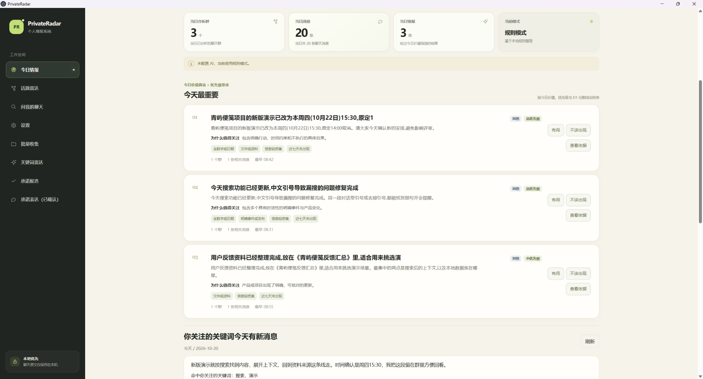
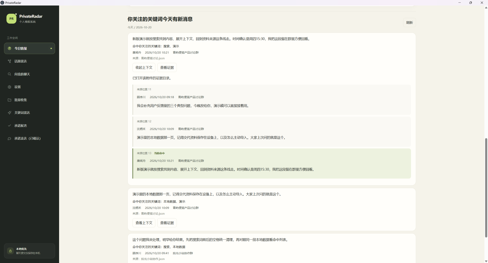
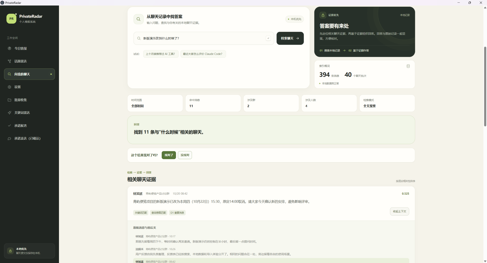
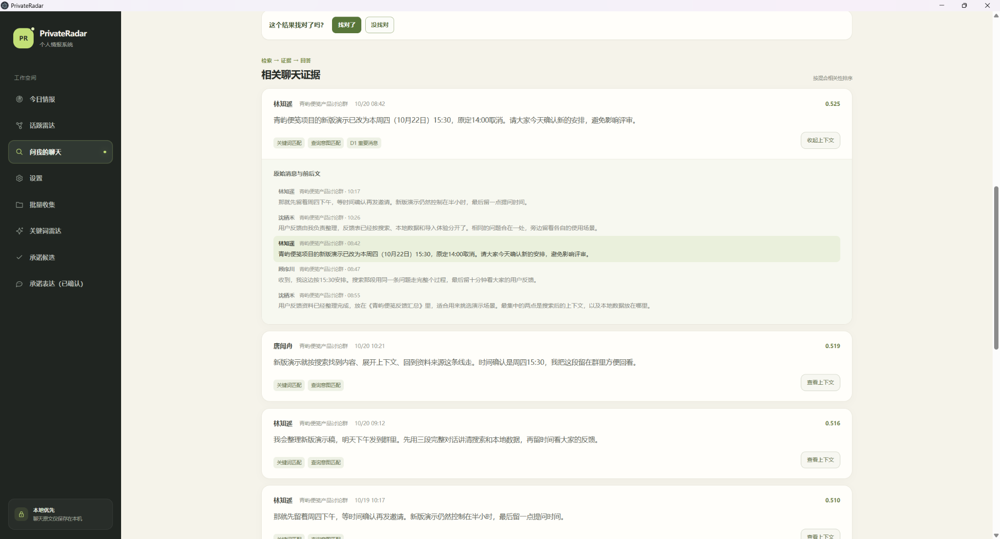
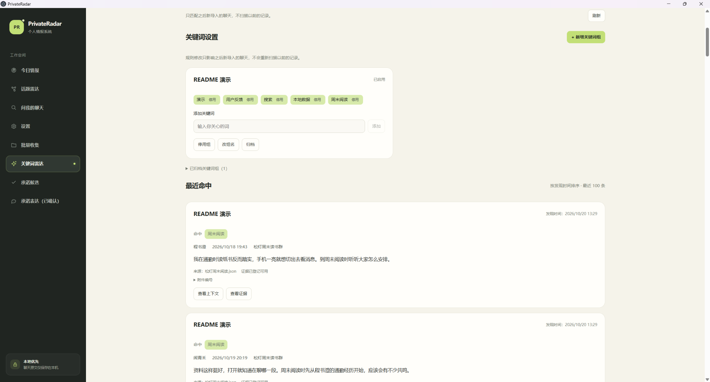
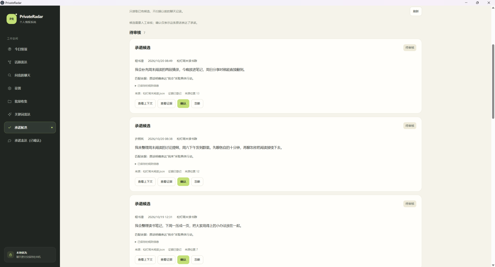
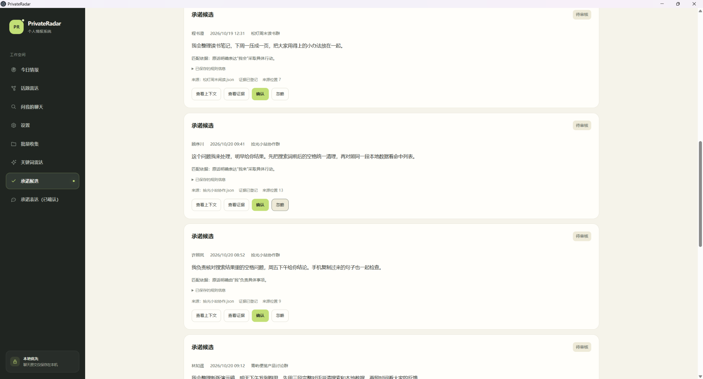

# PrivateRadar

Local-first personal chat intelligence: turn imported chats into daily intelligence, topic radar, searchable Q&A, and reviewable commitment candidates.

整理主动导入的聊天，查看今日情报、检索原文，并人工审核承诺候选。

[](./LICENSE)  

## 下载与安装

**[下载当前版本：v0.2.0-alpha.22（预发布）](https://github.com/moshangliu12-afk/PrivateRadar/releases/tag/v0.2.0-alpha.22)**

在发行页的附件列表中，选择适合你设备的安装包：

| 平台 | 安装包 | 安装前须知 |
|---|---|---|
| Windows x64 | `PrivateRadar-Setup-0.2.0-alpha.22-x64.exe` | 未签名，可能出现 SmartScreen / 未知发布者提示 |
| macOS | `PrivateRadar-0.2.0-alpha.22-macOS-arm64.dmg` | 仅 Apple Silicon / arm64（arm64 only），unsigned（未签名）、not notarized（未公证）；不支持 Intel x64 |

可从对应 GitHub Pre-release 下载当前安装包，并使用 `SHA256SUMS.txt` 核对摘要。安装与首次启动见[使用指南](./USER_GUIDE.md)。

**alpha.22 已提供预发布安装包、FFmpeg 对应源码和摘要清单。仓库现已公开。**



从当天聊天中，找到值得优先关注的信息。

*截图来自 alpha.22 本地候选，聊天内容均为虚构演示数据。*

## 能做什么

- **今日情报**：筛选当天值得关注的信息，按优先级查看，并回到原始依据。
- **话题雷达**：观察聊天中重复出现的话题及其变化。
- **问我的聊天**：检索本地聊天记录，查看相关原文、来源和上下文。
- **关键词雷达**：设置关注词，记录之后新导入聊天中的命中内容。
- **承诺候选**：识别明确的第一人称行动表达，由你查看依据、确认或忽略。
- **本地优先**：聊天原文与索引保存在本机；可选远程 AI 服务的数据发送边界见[隐私说明](./PRIVACY.md)。

## 功能展示

### 今日情报与关键词新消息

除了“今天最重要”，还可查看关注词当天命中的聊天、来源和证据上下文。关键词命中与重要情报分别展示。

<details>
<summary>查看关键词新消息与来源上下文</summary>



</details>

### 问我的聊天：检索与证据

输入“新版演示改到什么时候了？”，查找相关聊天，再展开前后文核对 10 月 22 日 15:30 的安排。截图展示本地全文检索结果，答案的依据始终可以回到原文查看。



<details>
<summary>展开查看原始消息与前后文</summary>



</details>

### 关键词雷达

关注演示、用户反馈、搜索、本地数据或周末阅读，查看命中的聊天与来源。规则只作用于设置之后新导入的聊天，不重新扫描历史记录。



### 可审核的承诺候选

候选保留原话、上下文和来源证据，由你确认或忽略。确认仅表示这条原话表达了承诺，不表示承诺已履行，也不会自动生成任务。



<details>
<summary>查看更多承诺候选</summary>



</details>

---

## 当前状态

- 当前版本为 `0.2.0-alpha.22`，已提供 [v0.2.0-alpha.22 Pre-release](https://github.com/moshangliu12-afk/PrivateRadar/releases/tag/v0.2.0-alpha.22)。发行源码及标签固定为 `a4d9174c713341243a00799c3432543aaa4e7747`；发布整合和文档收尾不改变发行资产身份。Windows 安装、启动、重启与普通导入人工验收通过；macOS arm64 DMG 已通过 GitHub Actions 构建、架构、许可及 DMG 检查，没有 alpha.22 实体 Mac 人工验证。仓库现已公开。
- 历史版本为 [v0.2.0-alpha.21 预发布版](https://github.com/moshangliu12-afk/PrivateRadar/releases/tag/v0.2.0-alpha.21)。该历史版本 Windows x64 安装器已完成 1674 / 1674 测试、构建、隐私扫描与人工验收；macOS arm64 DMG 已通过 CI 打包与检查，尚无 alpha.21 实体 Mac 人工运行验收记录。
- 历史完成并封板版本：[v0.2.0-alpha.20](https://github.com/moshangliu12-afk/PrivateRadar/tree/v0.2.0-alpha.20)。Windows 11 x64 的正式部署与验收结论保留，旧 annotated tag 和 Release 的历史身份不变。
- [alpha.20 Pre-release 档案页](https://github.com/moshangliu12-afk/PrivateRadar/releases/tag/v0.2.0-alpha.20)没有上传该版本 Windows 安装器、Skill 或 macOS 资产；当前开发候选不挂到旧 Release。
- Windows 正式导入链：微信 → WorkBuddy → PrivateRadar。macOS 仅提供手动 JSON 导入；PrivateRadar 自己的原生微信分享入口继续延期。

## alpha.22 发行资产

| 文件 | 平台与范围 |
|---|---|
| `PrivateRadar-Setup-0.2.0-alpha.22-x64.exe` | Windows x64，unsigned，人工验收通过 |
| `PrivateRadar-0.2.0-alpha.22-macOS-arm64.dmg` | Apple Silicon / arm64 only，unsigned、not notarized；CI / DMG 检查通过，无实体 Mac 人工验证 |
| `PrivateRadar-0.2.0-alpha.22-ffmpeg-corresponding-source.tar.xz` | 两平台共用的对应源码、许可与包内 provenance |
| `SHA256SUMS.txt` | 仅记录以上三个正式下载文件，不记录自身或发布说明 |

以上资产均绑定发行源码提交 `a4d9174c713341243a00799c3432543aaa4e7747`，下载与摘要见 [alpha.22 发行页](https://github.com/moshangliu12-afk/PrivateRadar/releases/tag/v0.2.0-alpha.22)。诊断报告、`.app.zip` 与外置 provenance 不作为正式发行资产。

<a id="alpha21-发行资产计划"></a>

## 历史 alpha.21 发行资产

| 文件 | 平台与范围 |
|---|---|
| `PrivateRadar-Setup-0.2.0-alpha.21-x64.exe` | Windows x64，unsigned，非 Microsoft Store 分发 |
| `PrivateRadar-0.2.0-alpha.21-macOS-arm64.dmg` | Apple Silicon / arm64 only，unsigned、not notarized、无 Developer ID；不提供 Intel x64 |
| `PrivateRadar-0.2.0-alpha.21-ffmpeg-corresponding-source.tar.xz` | 两平台共用的 FFmpeg 对应源码、许可及包内 provenance |
| `SHA256SUMS.txt` | 已随 Release 提供，仅记录以上三个文件的摘要，不记录自身 |

上述四项已作为 alpha.21 Release 资产提供。Windows 安装器、macOS DMG 与 FFmpeg 对应源码包均绑定发行源码提交 `6f04bb6f8ecf4c0bfaf4c622f4191f73c759d866` 并经核验。Windows 安装器 SHA256 为 `abf498dba9e52df69ac64282509ba14eea2df03372e93520eda6ea54756f0c91`；三个正式文件的摘要见该 Release 的 `SHA256SUMS.txt`。`.app.zip` 仅用于 CI / 内部验收；外置 provenance manifest 仅为内部材料，不增加第五项资产。GitHub 自动生成的源码 ZIP / tar.gz 不属于手工上传资产，也不能代替 FFmpeg 对应源码包。

Windows 可能出现 SmartScreen / 未知发布者提示；核验来源和摘要后，仅在系统提供选项时选择“更多信息 → 仍要运行”，不关闭 Defender 或系统级安全功能。Mac 文件名不含 `unsigned` 不代表已经签名；普通用户无需 Apple Developer Program。安装与首次启动步骤见 [使用指南](./USER_GUIDE.md)。

## macOS 验收与当前范围

| 验收层次 | 当前状态 |
|---|---|
| Apple Silicon 源码 / 运行时 | `PASS`，Stage2C 自动化与实体 M4 源码验收已完成 |
| alpha.20-derived unsigned arm64 CI 打包 | `PASS`，仅作为已验收参考候选 |
| alpha.20-derived 打包应用核心功能实机验收 | `PASS` |
| alpha.20-derived 实体安装与首次启动 | `PASS_WITH_ISSUE`，首次启动需处理该 App 自身 quarantine |
| alpha.22 DMG / CI | `PASS`，固定发行提交的 arm64 未签名 DMG 已提供；无实体 Mac 人工验证 |
| alpha.21 历史 DMG / CI | `PASS`，arm64 未签名 DMG 已作为 Release 资产提供；尚无实体 Mac 人工运行验收记录 |
| Developer ID / notarization / stapling | 当前 unsigned 策略不采用，不作为发行 blocker |

此前参考候选已核验 DMG SHA256、安装至 `/Applications`，synthetic JSON 导入、Search、承诺候选、确认、已确认表达、Evidence、退出重启及持久化均通过，无崩溃、无数据丢失。这是 **alpha.20-derived reference runtime acceptance**，不是 alpha.21 DMG 的实机验收。

参考候选首次启动曾提示“PrivateRadar 已损坏，无法打开”。用户核验下载来源和 SHA256 后，仅执行 `xattr -dr com.apple.quarantine "/Applications/PrivateRadar.app"` 移除该 App 自身 quarantine，随后启动成功。具体操作及边界见使用指南；不修改其他 App 或系统级安全策略。

Mac 仅接受 JSON，未接入 Windows WorkBuddy 正式链，也不承诺 CSV / TXT 能力。alpha.21 已完成 CI / DMG 检查；实体 Mac 人工运行验收与参考候选分开记录。macOS 安装包已提供不表示 WorkBuddy Connector 已支持 macOS；alpha.22 已完成独立 CI / DMG 核验，不继承参考候选的实机 PASS。

B0-1 / B0-2 / B0-3 / B0-4 均为 `PASS`，`P0_BINARY_LICENSE_BLOCKER_COUNT = 0`。alpha.21 已完成统一发行提交的产物与对应源码核验；alpha.22 安装资产、对应源码及许可交付已独立核验并随 Release 提供。这不重新打开 B0-4，也不要求重做 FFmpeg replacement physical smoke test。

历史敏感信息清理已完成，GitHub Support 流程已结束，不再作为技术阻塞项。仓库现已公开；alpha.22 预发布与在线资产核验已完成，本版本仍为 Pre-release。

## 当前核心能力

- 今日情报：保守筛选与优先级排序，查看“今天最重要”和原始依据。
- 今日关注词区块：“你关注的关键词今天有新消息”展示用户显式关注信号，独立于“今天最重要”；关键词命中不等于最重要。只消费已有命中，按可靠来源聊天时间判断当前本地日历日期。
- 问我的聊天 / 搜索：FTS5、关键词和日期 / 群 / 人物条件，提供有限证据与上下文；真实语义检索仍不属于当前正式能力。
- 话题雷达：保守话题识别、七天历史基线、值得注意程度与趋势展示，保留来源依据。
- 关键词雷达：用户配置关注词，查看真实来源命中、上下文和附件证据。
- 承诺候选：确定性识别明确承诺表达，由用户确认或忽略。
- 承诺表达（已确认）：只读回看用户已确认的原话；确认表达不代表承诺已履行，也不自动生成任务。
- 上下文与原始证据：关键词和承诺结果绑定来源出现位置，查看对应来源的上下文并打开附件证据。
- Windows 导入：WorkBuddy 单卡与同次双卡走原始上下文链，保留独立附件证据及来源关系；另有 JSON、CSV、TXT 文件导入。macOS 入口仅为手动 JSON。

候选不是事实。来源事实以原始证据和来源出现位置为依据，分析结果不能替代原文；用户确认后形成审核结果，仍能回到原始依据。缺失或不可靠的来源信息保持保守处理，不由规则或模型补造。

无需微信或真实聊天记录也可体验演示模式，包含 4 个模拟群、8 个模拟用户、连续 7 天、1468 条本地消息。

## 源码开发启动

开发环境要求 Node.js 24 或更高版本，使用 npm 和现有锁文件安装。在项目目录打开终端（Windows 可用 PowerShell）：

```powershell
npm ci
npm run dev
```

应用首次启动会创建空数据库。运行数据默认进入 Electron 的用户数据目录，开发环境的显式目录覆盖见隐私说明；开发时可通过 `.env.example` 中的开关注入内置 Demo。

Windows 文件导入的字段和示例见 [IMPORT_FORMATS.md](./IMPORT_FORMATS.md)；Mac 入口只使用其中的 JSON 格式。Windows 正式 WorkBuddy 操作和 Mac 边界见 [使用指南](./USER_GUIDE.md)。开发依赖安装、Electron 安装脚本及换行注意事项见 [贡献指南](./CONTRIBUTING.md)。

## 自检

```powershell
npm test -- --maxWorkers=2 --testTimeout=30000
npm run typecheck
npm run build
```

alpha.22 最终 Windows 安装器已通过与人工验收包的 104 个 payload 文件逐项摘要比较，继承安装、启动、重启和普通导入验收；FFmpeg 对应源码已生成，macOS 最终 DMG 已通过本轮自动构建和静态核验，没有实体 Mac 人工验证。实体 M4 Mac 源码运行和此前 unsigned 包的实机测试仅为历史参考证据，不代替 alpha.22 实机验收。当前锁定 Electron 44.3.0，Electron 二进制安装需要其安装脚本成功执行，排查步骤见贡献指南。源码开发自检不能代替最终安装包验收。

Windows x64 安装器构建命令为 `npm run dist:win`，输出到 `release/`；该命令用于本地构建，已验收安装器见当前 alpha.22 Release。

## 当前目录

```text
PrivateRadar/
├── src/
│   ├── main/        Electron 主进程、SQLite、演示数据
│   ├── preload/     安全的页面调用桥
│   ├── renderer/    React 界面
│   └── shared/      标准消息与共享类型
├── tests/           自动测试
├── PRIVATE_RADAR_REFERENCE_RESEARCH.md
├── DEVELOPMENT_PROGRESS.md
└── package.json
```

## 隐私与安全

- 聊天原文默认只保存在本机。
- 不读取或破解微信数据库，不 Hook 微信，不提取密钥。
- 不提交 API Key、Token、本地数据库或真实聊天导出。
- 可选远程 AI 与独立的 Embedding 服务由用户在本机配置。配置后，启动读取日报、刷新或搜索可能自动发送聊天相关证据，现有实现没有逐次确认门禁；两者均未配置时使用本地规则模式。发送内容、缓存与服务责任边界见 [隐私说明](./PRIVACY.md)。

## AI 开发配置

复制 `.env.example` 中需要的变量到本机环境。可将 `PRIVATE_RADAR_AI_PROVIDER=mock` 和 `PRIVATE_RADAR_EMBEDDING_PROVIDER=mock` 分别用于两个不联网的 Provider；远程服务需要配置 Base URL、Model 和 API Key。任何密钥都不应写入源码、日志或提交到 Git。

## 文档导航

当前入口：[使用指南](./USER_GUIDE.md)、[开发进度](./DEVELOPMENT_PROGRESS.md)、[隐私说明](./PRIVACY.md)、[安全报告](./SECURITY.md)、[贡献指南](./CONTRIBUTING.md)、[第三方许可清单](./THIRD_PARTY_NOTICES.md)。[已知问题与范围](./KNOWN_ISSUES.md) 和 [文件格式](./IMPORT_FORMATS.md) 保留 Windows 封板与专项记录，Mac 当前边界以本页和使用指南为准。当前原始上下文导入技术契约见 [WorkBuddy 模块说明](./src/main/integrations/workbuddy/README.md)。

历史与设计记录：[历史检查点](./docs/PROJECT_CHECKPOINT.md)、[alpha.15 候选发布说明](./ALPHA_RELEASE_NOTES.md)及[历史检查表](./ALPHA_RELEASE_CHECKLIST.md)保留当时状态；D1 / D2 / E1 设计、研究与专项验收数字也是阶段记录，不代表当前待办或最新验收结果。当前版本与发布状态以本页“当前状态”为准。

## 联系

如果你有使用反馈、合作建议或其他问题，可以通过以下方式联系：

- GitHub Issues：适合 Bug、功能建议和公开讨论
- Email：[alenshao1@proton.me](mailto:alenshao1@proton.me)

安全漏洞请优先使用 GitHub Private Vulnerability Reporting 私下提交。

## 许可证

项目自身采用 [Apache-2.0](./LICENSE)。第三方组件保留各自许可证与通知要求。B0-1～4 已闭环；alpha.21 对应源码与许可材料已核验，alpha.22 对应源码及最终发行资产已绑定固定发行提交并独立核验，见 [第三方许可清单](./THIRD_PARTY_NOTICES.md)。FFmpeg 对应源码采用保守超集交付，不承诺按位复现官方二进制。
